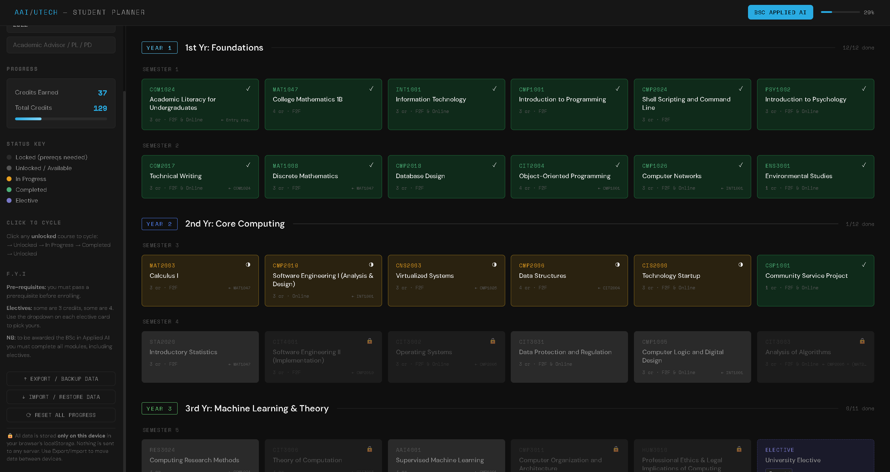
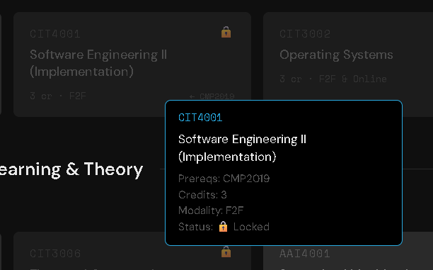
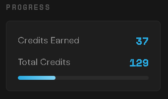
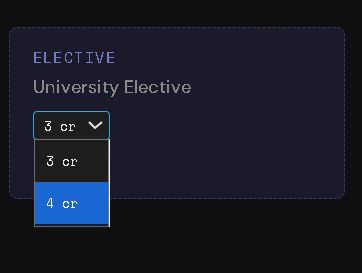
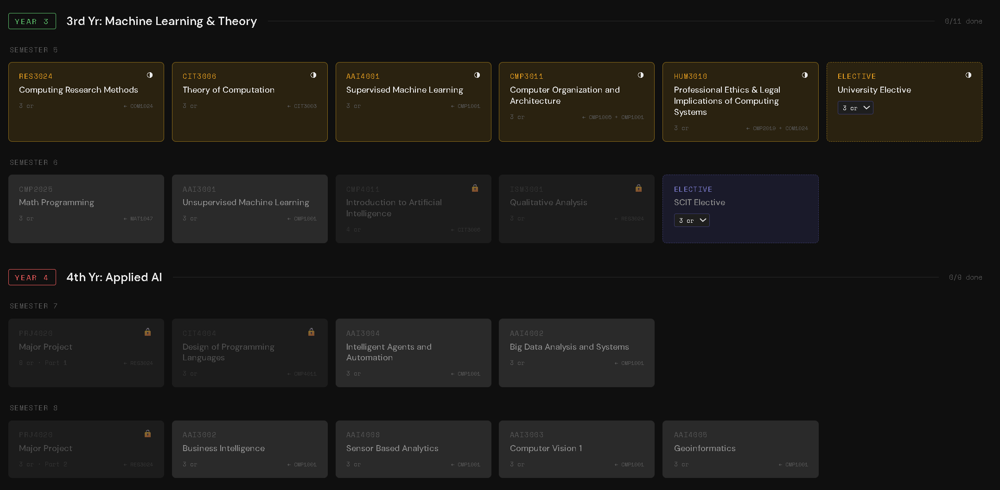

# utech-ai-planner

> An interactive degree-progress tracker for UTech Jamaica **BSc Applied Artificial Intelligence** students.



---

## What It Does

Click any unlocked course to cycle its status: **Available → In Progress → Completed**.  
Prerequisite courses unlock automatically as you complete their dependencies.  
Credits and overall percentage update in real time.

**No account. No server. Nothing leaves your browser.**

---

## Features

| Feature | Detail |
|---|---|
| 🎓 Single programme | BSc Applied Artificial Intelligence — 4 years, 8 semesters |
| 🔒 Prereq locking | Courses unlock only when dependencies are met (including "either/or" prereqs) |
| 🎚 Elective credits | Pick 3 or 4 credits for each elective from a dropdown on its card |
| 📊 Live credit counter | Tracks earned vs. total credits; header % and sidebar agree |
| 🏫 Modality shown | F2F / Online / F2F & Online shown on each Year 1–2 card |
| 💾 Offline-first | All data in `localStorage` — works without internet |
| 📤 Export / Import | JSON backup so you can move data between devices |
| 🔐 XSS-safe | All output escaped; no user data ever hits a server |

---

## Screenshots

> _Placeholders — drop the images into `screenshots/` with these names._

| View | Description |
|---|---|
|  | Years 1 and 2 of the full 4-year plan |
|  | Locked courses with tooltip showing missing prereqs |
|  | Sidebar credits counter updating after completions |
|  | Choosing 3 or 4 credits for an elective |
|  | Years 3 and 4 — machine learning and applied AI modules |

---

## How to Use

1. **Open** `index.html` in any browser — no install needed.
2. **Click a course** to mark it In Progress, then Completed.
3. **Set elective credits** using the dropdown on each elective card.
4. **Export** your progress via the sidebar to back it up or move to another device.

---

## Local Development

```bash
git clone https://github.com/YOUR_USERNAME/utech-ai-planner.git
cd utech-ai-planner
# Open index.html in your browser — that's it.
```

No build step. No dependencies. Pure HTML/CSS/JS.

---

## Project Structure

```
utech-ai-planner/
├── index.html          # Entire app — single file
├── screenshots/        # README screenshots
│   ├── full-view.png
│   ├── prereq-lock.png
│   ├── credits-sidebar.png
│   ├── elective-credits.png
│   └── years-3-4.png
└── README.md
```

---

## Curriculum Data

Course data is sourced from the official **UTech Jamaica SCIT Module Selection Guide — BSc Applied Artificial Intelligence** (revised March 2026).

| Year | Semesters | Credits |
|---|---|---|
| 1 — Foundations | 1, 2 | 36 |
| 2 — Core Computing | 3, 4 | 35 |
| 3 — Machine Learning & Theory | 5, 6 | 34 |
| 4 — Applied AI | 7, 8 | 24 |
| **Total** | | **129** (with 3-credit electives) |

Notes on how the guide is modelled:
- **PRJ4020 Major Project** runs across Semester 7 (0 cr) and Semester 8 (3 cr); it appears as two cards, Part 1 and Part 2.
- **CIT3003 Analysis of Algorithms** requires CMP2006 **and** either MAT2003 **or** MAT1008.
- **COM1024**'s requirement (COM1001 or CSEC/CAPE grade) is an entry requirement, so it is shown but never locks the course.
- The University Elective (Sem 5) and SCIT Elective (Sem 6) default to 3 credits; switch to 4 if your chosen elective is 4 credits.
- Year labels ("Foundations", etc.) are the planner's own; the guide only numbers the semesters.

---

## Security Notes

- All HTML output is escaped with a custom `esc()` function; tooltips are built with `textContent`.
- No inline event handlers are built from data — clicks are handled by delegated listeners.
- `localStorage` reads are validated — only known course IDs and status values are accepted.
- No external API calls. CSP meta tag blocks external script injection.
- Student info has `<` and `>` stripped and is capped at 200 characters before storage.
- Storage keys are prefixed `aai_` so this planner never clashes with other UTech planners on the same site.

---

## Contributing

Found a course discrepancy? Open an issue or pull request.  
Contributions welcome — especially if UTech updates the programme structure.

---

## License

MIT — free to use, share, and modify.

---

*Built for UTech Jamaica Applied AI students. Not an official UTech product.*
